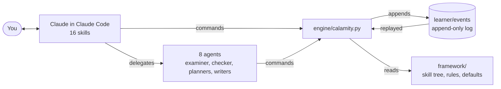

# The Calamity Framework

[](https://github.com/persxn/calamity-framework/actions/workflows/tests.yml)
[](LICENSE)

**A learning system that runs inside [Claude Code](https://code.claude.com/docs).
Clone it, open Claude Code in the folder, and you have a tutor that teaches
in small chunks, tests each one at once, brings old material back before you
forget it, and keeps an honest record of what you can actually do.**

It ships with three tools built on one method:

- **An adaptive tutor** for development, programming, maths and AI: a skill
  tree of 150 skills with prerequisites, a route to any goal, syllabi written
  for you from current official documentation, and exercises that weave the
  skills you learnt earlier into the one you are learning now.
- **A GATE companion** (CS and DA papers): follows you through your own
  course or playlist, tests every lecture the day you watch it, plans back
  from the exam date, and ranks subjects by marks still to gain per hour.
- **A competitive-programming coach**: reads your Codeforces record, finds
  what is holding your rating back, sets problems just above your level with
  the tags hidden, and reviews your contests.

What makes it different:

1. **Recall before re-teaching.** Every session opens with questions on
   earlier material, from any skill, unannounced. Reviews are scheduled with
   FSRS-6, a published model of memory.
2. **A small chunk, then a test.** One idea, one worked example, one thing
   to do, then a question. Nothing counts as learnt until it has been
   answered.
3. **Earlier skills woven into new exercises.** A Java exercise that also
   needs a Dockerfile and a commit credits all three.
4. **Questions checked before you see them.** One agent writes each practice
   question; a second solves it blind, computing wherever it can, and only
   questions whose independent answer matches the sealed key reach you.
5. **A finish line, not points.** Each day has a countable finish line:
   reviews due, new topics, lectures. Reaching it is the day done. There are
   no points, levels or streaks.

Your record is plain text in your own folder. Nothing is sent anywhere, and
there is no telemetry.

## Contents

- [What it looks like](#what-it-looks-like)
- [Requirements](#requirements)
- [Installation](#installation)
- [Your first session](#your-first-session)
- [Everyday use](#everyday-use)
- [The three tools](#the-three-tools)
- [Your data](#your-data)
- [Optional extras](#optional-extras)
- [Configuration](#configuration)
- [Updating and removing](#updating-and-removing)
- [Troubleshooting](#troubleshooting)
- [FAQ](#faq)
- [How it works](#how-it-works)
- [Contributing](#contributing)
- [Known limits](#known-limits)
- [Licence and credits](#licence-and-credits)
- [Documentation](docs/README.md)

## What it looks like

Claude talks with you; the numbers come from the framework's engine. The
output below comes from real engine runs on a **pretend learner**, made by
`tools/demo.py` in a throwaway copy, and is shown unchanged.

A learner who has just said they want to become a MERN developer, and
enrolled a first skill. The route to their goal, in layers that can be
studied in parallel:

```
$ python3 engine/calamity.py tree path mern-stack
Route to mern-stack | MERN capstone
layer 1 (start here): ◐ dev-environment
layer 2: · javascript   · linux-shell   · html-css
layer 3: · mongodb   · node   · networking   · npm-bundlers   · git-gh
layer 4: · rest-api-design   · react   · tailwind
layer 5: · express
layer 6: · mern-stack
about 372 hours across 14 skill(s) at the mastery standard (estimates from the skill files)
choices on this route (enrol in an alternative and the route follows it):
  language: javascript (or python, java, kotlin)
✓ mastered or known   ◕ ready (unlocks the next skills)   ◐ learning
○ open to start   · locked
```

What to start next, and the roadmap of their track:

```
$ python3 engine/calamity.py tree suggest
Nothing else is open to start yet.
  dev-environment unlocks linux-shell, html-css, javascript, python, java, sql-modelling ... once it is ready
Carry on with what is enrolled (the route to a goal: tree path <skill>), or add a skill: tree add ...
```

```
$ python3 engine/calamity.py dash roadmap --width 78
10x Developer  [77 skills: 1 learning, 76 locked]
 foundations
   ◐ dev-environment   · linux-shell   · git-gh   · networking
 web-core
   · html-css   · javascript   · typescript   · npm-bundlers
   · eslint-prettier
 frontend
   · react   · vue?   · svelte?   · tailwind   · redux   · tanstack-query
   · framer-motion   · gsap   · a11y-performance   · jest   · playwright
   · cypress
 api
   · rest-api-design   · openapi   · graphql   · websockets   · grpc?   · trpc
 backend
   · node   · express   · fastify   · nestjs   · nextjs   · python   · fastapi
   · java   · spring-boot   · auth-basics   · jwt   · oauth2   · queues-jobs
 data
   · sql-modelling   · postgresql   · mongodb   · prisma   · redis
 devops
   · docker   · docker-compose   · github-actions   · jenkins?
   · cloud-basics   · nginx-tls   · kubernetes   · terraform
   · prometheus-grafana   · tracing-logging
 mobile
   · kotlin   · android-core   · android-state   · android-data
   · android-testing   · android-release   · dart   · flutter
   · flutter-state   · flutter-data   · flutter-release
 engineering
   · testing-basics   · dsa-foundations   · web-security   · system-design
 milestones
   · mern-stack   · frontend-engineer   · backend-engineer
   · fullstack-production   · devops-platform   · android-app   · ten-x

✓ mastered or known   ◕ ready (unlocks the next skills)   ◐ learning
○ open to start   · locked   ? optional
details: tree show <skill>   route to a goal: tree path <skill>
what next: tree suggest
```

Another pretend learner, six simulated weeks into the developer track,
competitive programming and GATE CS, on an evening after a missed day:

```
$ python3 engine/calamity.py dash --width 78
CALAMITY · Asha · Mon 12 Oct 19:40
reviews ░░░░░░░░░░ 0/29   new ░░░░░░░░░░ 0/6
finish line: 27 reviews, 6 new to go
──────────────────────────────────────────────────────────────────────────────
10x Developer
  ◕ dev-environment           ██████████ 4/4 solid · boss passed
  ◕ linux-shell               ████████░░ 5/6 solid · boss passed
  ◕ git-gh                    ██████████ 6/6 solid · boss passed
  ◕ html-css                  ████████░░ 4/5 solid · 1 due, boss open
  ◕ javascript                ████████░░ 5/6 solid · boss open
  ◐ typescript                ░░░░░░░░░░ 0/5 solid · 4 due, boss open
Competitive Programming
  ◕ cp.cpp                    █████████░ 9/10 solid · 1 due, boss open
  ◐ cp.stl                    █████░░░░░ 6/12 solid · 2 due, boss open
  ✓ cp.rating-1200            ██████████ milestone
GATE (common to every paper)
  ◕ gate.general-aptitude     ██████████ 16/16 solid · 1 due
GATE Computer Science and Information Technology (CS)
  ◕ gate.cs.discrete-math     █████████░ 11/12 solid · 1 due
  ◕ gate.cs.digital-logic     █████████░ 7/8 solid · 1 due
  ◐ gate.cs.coa               ░░░░░░░░░░ 0/10 solid · 4 due
  ◐ gate.cs.programming-ds    ░░░░░░░░░░ 0/10 solid · 7 due
  ◐ gate.cs.algorithms        ████░░░░░░ 4/10 solid
  ◐ gate.cs.toc               ███░░░░░░░ 3/9 solid · 1 due
  ◕ gate.cs.compiler-design   ██████████ 7/7 solid · 3 due
  ◐ gate.cs.operating-systems ░░░░░░░░░░ 0/11 solid · 3 due
  ◕ gate.cs.databases         ██████████ 11/11 solid
  ◕ gate.cs.computer-networks ██████░░░░ 10/16 solid
  ◐ not started yet (3): gate.cs.linear-algebra   gate.cs.calculus
      gate.cs.probability
✓ mastered or known   ◕ ready (unlocks the next skills)   ◐ learning
○ open to start   · locked
```

```
$ python3 engine/calamity.py today
today: reviews 0/29 · new 0/6 · finish line: 27 reviews, 6 new to go
answered today: 0 (0 correct) · active about 1 min
due now (29): gate.cs.programming-ds/trees, html-css/grid, gate.cs.operating-systems/cpu-scheduling, gate.cs.operating-systems/file-systems, gate.cs.programming-ds/c-programming, typescript/interfaces, gate.cs.programming-ds/recursion, gate.cs.discrete-math/sets-relations ...
new, in order: gate.cs.programming-ds/binary-search-trees, gate.cs.programming-ds/binary-heaps, gate.cs.programming-ds/graphs, gate.cs.calculus/limits-continuity, gate.cs.calculus/differentiability, gate.cs.calculus/maxima-minima
next: review gate.cs.programming-ds/trees
```

## Requirements

| You need | Check it with | Notes |
|---|---|---|
| [Claude Code](https://code.claude.com/docs/en/setup) and a plan that includes it | `claude --version` | A Pro, Max, Team, Enterprise or Console account; the free claude.ai plan does not include Claude Code. macOS 13+, Windows 10 1809+, Ubuntu 20.04+ or Debian 10+, 4 GB RAM. |
| Python 3.9 or newer | `python3 --version` (Windows: `py -3 --version`) | Standard library only: nothing to `pip install`. |
| git | `git --version` | To clone the framework and keep your progress in a repository of your own. On Windows, Git for Windows. |
| Optional: a TeX engine | `tectonic --version` or `pdflatex --version` | Only for PDF notes: Tectonic, TeX Live or MiKTeX. |

The Claude Code facts here were read from its official setup page on
2026-10-12.

## Installation

Each guide in `docs/` goes through these steps in more detail:
[Linux](docs/setup-linux.md), [macOS](docs/setup-macos.md),
[Windows](docs/setup-windows.md).

### 1. Install Claude Code

macOS, Linux or WSL:

```bash
curl -fsSL https://claude.ai/install.sh | bash
```

Windows PowerShell:

```powershell
irm https://claude.ai/install.ps1 | iex
```

Other ways (Homebrew `brew install --cask claude-code`, WinGet
`winget install Anthropic.ClaudeCode`, Linux package repositories, npm) are
on the [official setup page](https://code.claude.com/docs/en/setup). Then
open a new terminal and check:

```bash
claude --version
```

The first time you run `claude`, it opens your browser to sign in.

### 2. Get the framework

Linux and macOS:

```bash
git clone https://github.com/persxn/calamity-framework.git calamity
cd calamity
python3 engine/calamity.py doctor
```

Windows (PowerShell; if `python` is not found, use `py -3`):

```powershell
git clone https://github.com/persxn/calamity-framework.git calamity
cd calamity
python engine/calamity.py doctor
```

`doctor` should end with `0 problem(s)`. Two warnings are normal on a new
clone: no learner profile yet, and no session-start hook yet.

### 3. Open it in Claude Code

```bash
claude
```

Claude Code asks whether you trust this folder. **Accept**: until a folder
is trusted, Claude Code ignores the permission rules it ships in
`.claude/settings.json`, and every engine command would stop to ask you.
Those rules let Claude run the engine and edit your files under `learner/`,
ask before it changes the framework, and stop it from reading the answer
keys of your practice questions.

Then type:

```
/onboard
```

## Your first session

Onboarding takes ten to fifteen minutes:

1. **This machine.** Claude runs `doctor` and offers to install the
   session-start hook (it asks first), which gives Claude a short brief of
   where you stand at the start of every session.
2. **You.** Your name, what you want (the developer path, AI engineering,
   competitive programming, GATE, or one skill), where you want to get to
   first, whether you are starting fresh or refreshing, how you like to be
   taught, when you sleep, how many hours a day you aim for, and whether you
   want reminders. Nothing is assumed or prefilled.
3. **Each track.** What you already know (checked with a short placement
   test, not taken on trust); for competitive programming your Codeforces
   handle and target; for GATE the year, paper, target and what you study
   from.
4. **First skills and a day shape**: what you will start this week, and a
   first version of your day in `learner/schedule.md`.

Then `/study`. Practice questions are written and checked in the
background for the topics coming up; Claude teaches one small chunk, asks a
checked question, tells you at once whether you were right, and if not,
shows the solution, finds out why, and repairs the gap. More in
[your first session](docs/first-session.md).

**A normal day**: open Claude Code in the folder; answer the few recall
questions it opens with; `/study` until the finish line; log any lecture
you watched elsewhere with `/log`; `/sync` when you want your progress
saved.

## Everyday use

| Command | What it does |
|---|---|
| `/study [skill]` | A session: recall first, then one small chunk at a time, each tested at once |
| `/recall` | Only the questions that are due, as fast as you can answer |
| `/today` | Today's finish line and the next thing to do |
| `/dash [progress \| roadmap \| queue \| gate \| cp \| week \| all]` | Progress, roadmap, revision queue, GATE and Codeforces boards, the week |
| `/tree [show \| path \| next \| add \| drop ...]` | What a skill needs, the route to a goal, what to learn next; add, swap or drop skills |
| `/boss [skill]` | The project or timed test that proves a skill |
| `/log <source> <lecture>` | Record a lecture watched elsewhere (its test follows), or a workout |
| `/notes [skill]` | Notes per topic, LaTeX sections, one PDF per skill |
| `/gate` | The GATE companion |
| `/cp` | The competitive-programming coach |
| `/coach` | A review of how you have actually been working, and your schedule |
| `/bridge` | Connect a course site, playlist or book so its lectures enter the plan |
| `/remind` | Operating-system reminders that fire only when something is due |
| `/sync` | Commit and push your progress to your own repository |
| `/onboard` | First run, a new track, or a second laptop (`/onboard machine`) |
| `/update-framework` | A newer version of the framework, without touching your data |

Or just talk: "teach me Docker", "what should I do today?", "I finished
lecture 14", "quiz me", "I already know Git", "Fastify instead of Express",
"how did my week go?". More in [daily use](docs/daily-use.md).

## The three tools

### The skill tree and the tutor

| Track | Skills | What it covers |
|---|---|---|
| `10x` Developer | 77 | From a first terminal to production: Linux, Git, web, JavaScript and TypeScript, React (or Vue, Svelte), APIs, Node, Express (or Fastify, NestJS), Python, Java, databases, auth, Docker, CI, Kubernetes, Terraform, observability, security, system design, Android or Flutter, and capstone milestones |
| `ai` AI engineering | 17 | Maths, the Python data stack, classical ML, deep learning, transformers, serving, LLMs, local models, RAG, evaluation, agents |
| `cp` Competitive programming | 35 | C++ and the STL, then algorithms by rating band, with milestones from 1200 to 2200 (194 topics) |
| `gate`, `gate-cs`, `gate-da` | 21 | General Aptitude and every subject of the CS and DA papers (224 topics) |

- **Routes**: `tree path <goal>` lays out the skills to a goal in layers;
  skills in one layer can be learnt side by side, and they take turns.
- **Alternatives**: React, Vue or Svelte; Express, Fastify, NestJS, FastAPI
  or Spring Boot; GitHub Actions or Jenkins. Enrol in one and the route
  follows it.
- **Placement tests** check what you already know, so it is not taught
  again. **Mastery** mode learns a skill properly; **brush-up** refreshes
  it.
- **Bosses**: a project or timed test proves each skill, every check run
  for real.
- **Your tree**: add a skill the tree lacks, drop one you do not want, or
  take one early. Your changes live in `learner/` and survive updates.

See [the skill tree](docs/skill-tree.md).

### The GATE companion

Facts for GATE 2027 come from the official site, read on 2026-10-12: exam
days 6, 7, 13, 14, 20 and 21 February 2027 (liable to change), 65
questions, 100 marks, 3 hours, MCQ, MSQ and NAT with negative marking on
MCQs only. Practice questions follow that style and marking. You log each
lecture of your own course or playlist and are tested on it straight away;
`gate triage` ranks subjects by marks still to gain per hour of study left;
the `gate-strategist` agent plans back from the exam date and puts every
cut to you with its cost in marks; mocks are recorded and reviewed
question by question. It never promises a rank. See [GATE](docs/gate.md).

### The competitive-programming coach

`cf link <handle>` and `cf sync` read your public Codeforces record
through the official API: no password. `cf analyse` finds your weakest
tags against what your rating calls for, `cf recommend` picks unsolved
problems 100 to 300 above your rating with the tags hidden, solved problems
count as evidence for the skills they exercise, and the `cp-coach` agent
plans your weeks against your target and says plainly whether the pace
fits. During a rated contest it gives no help of any kind. See
[competitive programming](docs/competitive-programming.md).

## Your data

- **Everything about you is in `learner/`**: your profile, your day shape,
  an append-only log of everything you did, your practice questions (keys
  sealed), your syllabi, study sources and notes. All plain text;
  `learner/README.md` describes each folder.
- **Your own repository.** To keep your progress safe and use it on several
  computers, `/sync` pushes `learner/` to a repository of your own, private
  unless you choose otherwise. It commits and pushes only when you ask.
- **A second computer**: clone your repository, open Claude Code in it, and
  run `/onboard machine`. Each computer writes its own log file, so two
  laptops merge without conflicts and end up showing the same thing.
- **On a phone**: continue a session that runs on your computer from the
  Claude app or claude.ai/code with Claude Code's
  [Remote Control](https://code.claude.com/docs/en/remote-control):
  `/remote-control` in the session. Your computer must stay on, with
  `claude` running; it needs a Pro, Max, Team or Enterprise plan (read
  2026-10-12).

What it never does:

- **No telemetry.** The engine contacts one service, the public Codeforces
  API, and only when you link a handle and sync.
- **No passwords, cookies or tokens** are stored, ever.
- **No course content is copied.** Study sources are connected only by
  routes their terms allow; a site that disallows automated access is never
  fetched or scripted. Only which lectures you finished is recorded.
- **Nothing runs unasked.** The hook, the status line and reminders are
  installed only when you approve them; the repository ships no hook.

More in [syncing and devices](docs/syncing-and-devices.md) and
[study sources](docs/study-sources.md).

## Optional extras

All of these are per computer, written to files that are never committed,
and removable with one command.

| Extra | Install | Remove |
|---|---|---|
| **Session brief**: Claude reads where you stand as each session starts | `python3 engine/calamity.py setup --hook` | `python3 engine/calamity.py setup --remove-hook` |
| **Status line**: the day's numbers at the bottom of Claude Code, such as `CAL · due 3 · new 2/6 · GATE 117d` | `python3 engine/calamity.py setup --statusline` | `python3 engine/calamity.py setup --remove-statusline` |
| **Reminders**: notifications from your operating system, only when something is due, never in your sleep window | `/remind`, which runs `remind render --times 09:00,21:00` and shows you the install command | the remove command `remind render` prints |
| **PDF notes**: one PDF per skill from your notes | install Tectonic, TeX Live or MiKTeX; then `/notes pdf <skill>` | uninstall the TeX engine |

`setup --hook` and `setup --statusline` write `.claude/settings.local.json`;
reminders use crontab on Linux, a LaunchAgent on macOS and Task Scheduler
on Windows. See [daily use](docs/daily-use.md#reminders) and
[notes and PDFs](docs/notes-and-pdfs.md).

## Configuration

Everything about you is set by answering Claude's questions; the values go
into `learner/profile.md` through the engine, which checks them:

```bash
python3 engine/calamity.py profile show
python3 engine/calamity.py profile set sleep.start 00:30
python3 engine/calamity.py profile set name=Sam goals=mern-stack,cp.rating-1400
```

The keys the engine reads (all listed in `framework/rules/engine.md`):
`name`, `tracks`, `goals`, `focus`, `mode.default`, `teach.style`,
`sleep.start`, `sleep.end`, `workout.minutes`, `daily.target_hours`,
`reminders.times`, `gate.year`, `gate.papers`, `gate.exam_date.<PAPER>`,
`gate.target_marks.<PAPER>`, `cp.handle`, `cp.target_rating`,
`cp.target_date`, and others.

The framework's defaults live in `framework/config.md`: 8 new topics a day,
a learner day that starts at 04:00, reviews aimed at a 90% chance of
recall, a failed topic back after 10 minutes, what counts as solid and as
mastered, 3 surprise-recall questions, GATE and Codeforces settings. Do not
edit that file; override a value for yourself:

```bash
python3 engine/calamity.py profile set cfg.new_per_day 6
```

## Updating and removing

**Updating.** `/update-framework` fetches the newer version, shows you what
changed (versions, which areas, and any change to permissions or scripts in
full), merges it when you agree, and runs `selftest`, `doctor`,
`tree check` and `rebuild`. Your `learner/` folder is never touched by an
update.

**Removing**, from inside the folder (on Windows with `python` or `py -3`):

1. Take out the hook and the status line:

   ```bash
   python3 engine/calamity.py setup --remove-hook --remove-statusline
   ```

2. If you installed reminders, remove them with the command `remind render`
   printed (run it again to see it):

   ```bash
   python3 engine/calamity.py remind render
   ```

3. Keep your progress if you want it: push it with `/sync`, or copy the
   `learner/` folder somewhere.
4. Delete the folder. Claude Code keeps its own history of the conversations
   you had there under `~/.claude/`; its documentation explains how to
   remove that.

## Troubleshooting

`python3 engine/calamity.py doctor` checks everything and says what to fix.

| Symptom | Fix |
|---|---|
| `python3` not found, or it opens the Microsoft Store (Windows) | Use `python` or `py -3`. Onboarding records which works, and the brief names it. |
| Every engine command asks for permission | Accept the trust prompt: start `claude` in the folder again. |
| No brief at the start of a session | `/onboard machine` installs the hook; until then Claude runs the brief by hand. |
| `?` or boxes instead of `✓ ◕ ◐ ○ ·` in dashboards | Add `--ascii` to `dash` and `tree` commands. On Windows, Windows Terminal shows them. |
| "no TeX engine" when building notes | Install Tectonic, TeX Live or MiKTeX; the `.tex` files are ready meanwhile. |
| Codeforces sync fails | Check the connection; if Claude Code's sandbox is on, allow `codeforces.com`. |
| A setting seems ignored | `doctor` reports `cfg.` overrides it could not use. |
| The two laptops disagree | Sync both, then `rebuild` on each. |

More in [troubleshooting](docs/troubleshooting.md).

## FAQ

**Where do the questions come from?** They are written for you by one
agent and checked blind by another before you see them. No question bank
ships with the framework.

**Can a question still be wrong?** Rarely: the two agents are the same kind
of model. Say so, and it is solved again from scratch; a key that does not
hold is withdrawn and your answer stops counting.

**What does it cost?** The framework is free. It uses your Claude Code plan
like any other Claude Code work; writing and checking questions with agents
uses more of it than a plain chat.

**Do I need to know how to program?** No. You talk in plain words; you need
to paste a few commands to install it.

More in the [FAQ](docs/faq.md).

## How it works

Claude teaches, asks and judges. A Python program, the engine, keeps the
record and decides what comes next; every skill and agent works through it.



- **An append-only log.** Every answer, lecture and decision is one line in
  `learner/events/`. Schedules, mastery and dashboards are recomputed by
  replaying it, in an order that does not depend on which file a line is in,
  so two laptops that have synced always agree. A disposable snapshot
  spares a long log from being replayed in full on every command; the tests,
  the fuzzer and `doctor` check that it never changes a result.
- **FSRS-6** schedules each topic's next review from your answers: right,
  hinted, slow or wrong.
- **Standard library only**, Python 3.9 or newer, on Linux, macOS and
  Windows.

| Folder | What it holds |
|---|---|
| `CLAUDE.md`, `framework/method.md` | What Claude reads every session: its role and the method |
| `.claude/skills/`, `.claude/agents/` | The slash commands and the specialist agents |
| `framework/` | The skill tree, the rule books, the defaults, the exam facts; `framework/MAP.md` indexes everything |
| `engine/` | The engine and its tests |
| `learner/` | You |
| `docs/`, `tools/` | These guides; development checks |

More in [how it works](docs/how-it-works.md).

## Contributing

Contributions are welcome. There is nothing to install:

```bash
python3 engine/calamity.py selftest     # the engine's tests, including a lint of every document
python3 engine/calamity.py doctor       # the health of this checkout
python3 engine/calamity.py tree check   # the skill tree
python3 tools/e2e.py                    # the whole framework, as two laptops use it
```

A new skill for the tree is one Markdown file in `framework/tree/<track>/`;
run `tree check`. Every fix comes with a test, every engine command quoted
in a document must exist, and nothing from anyone's `learner/` folder goes
into a pull request. See [CONTRIBUTING.md](CONTRIBUTING.md) and
[SECURITY.md](SECURITY.md).

## Known limits

- **Questions are written and checked by models.** Two separate agents and
  a computed check catch most errors, not all. The framework says so and
  makes disputing a key easy.
- **Developer and AI skills ship a scope, not a syllabus.** Yours is
  written when you start the skill; its quality depends on the
  `curriculum-architect` agent and on the documentation it reads.
- **GATE subject weights are priors** until you import official papers or
  set figures with sources. Rank cannot be predicted, and the framework does
  not try.
- **What was tried where.** The engine's tests run on Linux, macOS and
  Windows with Python 3.9 to 3.15 on every change. Full Claude Code
  sessions (onboarding, the item agents, study, notes, sync) were run on
  Linux, non-interactively; macOS and Windows sessions, Remote Control,
  reminders on a real desktop, and MiKTeX were not tried by the
  maintainer. Live Codeforces syncing was tried once against the real API.
- **Claude Code shows command output.** In the terminal you can see the
  engine's replies to Claude, including the line naming a question's topic.
  Keys never appear before your answer is recorded.
- **Speed.** Commands normally start from the snapshot (about 0.2 seconds
  at 50,000 events on the machine it was measured on). After a merge from
  another laptop, a re-classified mistake or an update, one command replays
  the whole log (about a second at that size).
- **Usage.** Writing and checking questions with agents uses more of your
  Claude plan than a plain conversation.

## Licence and credits

MIT licence; see [LICENSE](LICENSE). Copyright (c) 2026 persxn.

- Review scheduling is an independent port of
  [FSRS](https://github.com/open-spaced-repetition/py-fsrs) by Open Spaced
  Repetition (MIT); see `engine/THIRD_PARTY.md`.
- Built for [Claude Code](https://code.claude.com/docs) by Anthropic.
- Competitive-programming data comes from the
  [Codeforces API](https://codeforces.com/apiHelp).
- GATE facts are from the organisers' official site; GATE is conducted by
  the IITs and IISc, which have no connection with this project.
