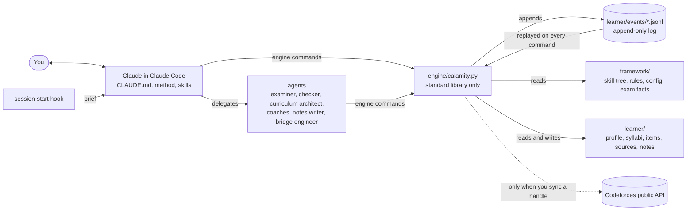

# How it works

Claude teaches, asks and judges. A small Python program, the engine, keeps
the record and decides what comes next. They meet at the command line:
every skill and agent works through `python3 engine/calamity.py ...`.



## The pieces

| Path | What it is |
|---|---|
| `CLAUDE.md` | What Claude reads at the start of every session: the role and the rules that never bend. The method, `framework/method.md`, is read by the study, recall, boss, gate and cp skills when they run, so it costs nothing in a session that does not use it. `engine/CLAUDE.md` is for maintainers and loads only when a session works in `engine/`. |
| `.claude/skills/` | The slash commands, each a short procedure, and the companion skills (`mastery-coach`, `mastery-textbook`, `build-it-yourself`). |
| `.claude/agents/` | The specialist agents, each with its own instructions and context. |
| `.claude/settings.json` | Permissions: the engine and edits under `learner/` are pre-approved; editing the framework asks first; reading item files and editing the log are denied. |
| `framework/` | The skill tree, the rule books, the default numbers (`config.md`), exam facts per year, the LaTeX preamble. The same for every learner. |
| `engine/` | The engine and its tests. |
| `learner/` | One learner's record. |
| `tools/` | Development checks (end-to-end run, fuzzer, sample output, timing). |

`framework/MAP.md` indexes everything and is where Claude looks things up.

## The event log

Every answer, lecture, enrolment, mock and observation is one line of JSON,
appended to `learner/events/<year>-<month>.<machine>.jsonl`. Nothing is
ever edited in place. Schedules, mastery, statistics and dashboards are
computed by **replaying** the log on every command.

- Each computer writes its own file, so two laptops never edit the same
  file, and `.gitattributes` tells git to keep both sides of any merge.
- Replay sorts events by time, then machine, then write order, then id, and
  drops duplicates: copying, reordering or merging files cannot change the
  result. The fuzzer checks this by dealing the same events out to other
  files in other orders.
- A damaged line (a merge conflict marker, a typo) is reported by `doctor`
  and skipped; it never stops the engine.
- Corrections are new events: a disputed question's answer is voided, a
  mistake is re-classified, a renamed topic keeps its history.

**The replay snapshot.** Replaying a long log takes time (about a second at
50,000 events on the machine it was measured on). So after each replay the
engine keeps the resulting state in `.calamity/cache/replay.json`, together
with exactly what it was built from: the size and SHA-1 of each log file it
read, and a key over everything else replay depends on (the engine's code,
`config.md`, your profile, the exam facts, each skill's track). A command
starts from the snapshot only when all of that still holds and the new
events all come after it; otherwise it replays everything. The snapshot is
plain JSON (never code), disposable, and checked: the tests and the fuzzer
compare it with a full replay after every step, and `doctor` compares the
two every time it runs. `CALAMITY_NO_CACHE=1` turns it off.

## Scheduling

Reviews are scheduled per topic with **FSRS-6**, a published memory model,
ported from py-fsrs 6.3.2 and checked number for number against it. A
grade comes from the answer, not from anyone typing one in: wrong is
*Again*; right with hints, or much slower than expected, is *Hard*; right is
*Good*; right and fast on a topic already known is *Easy*. A topic you get
wrong comes back within minutes, and again in later sessions. Reviews aim
at a 90% chance of recall when they come due (85% in brush-up mode). For
GATE, the last three weeks hold reviews tighter, and every topic that would
not otherwise come back gets one final review, spread across that phase.

## Verified practice

Questions are written for you by the `examiner` agent and stored with their
key and solution sealed. The `checker` agent, a separate context that never
sees the key, reads each question as you would, judges whether it is fair,
solves it (computing wherever possible), and submits its own answer; the
engine compares. Only questions that pass reach you, and the engine refuses
to show a key before your answer is recorded. Hands-on items (code, tasks)
carry a check instead of a key: the checker runs it against a reference
solution and confirms that it fails on an empty one.

Only answers to verified questions, judged Codeforces solves and checks
that were really run count towards mastery. An oral check, an answer given
after seeing the solution the same day, or a solve that followed an
editorial schedules the topic but is not counted as evidence.

The limit, stated in `framework/rules/verification.md`: the examiner and
the checker are the same kind of model, so a blind spot they share can pass
both. That is why the checker computes instead of reasoning where it can,
why official exam questions are anchored to official keys, and why a
disputed key always gets a fresh check instead of an argument.

## The session brief

With the hook installed, Claude Code runs `brief --hook` as each session
starts (and after `/clear` or compaction), and its output goes into
Claude's context: who you are, the day's finish line, what is due, the
next action, anything that needs attention. It is capped at 6,000
characters. Without the hook, Claude runs `brief` itself.

## Configuration

Defaults live in `framework/config.md`: new topics a day (8), lectures a
day (0, no quota), when a learner day starts (04:00), the target recall for
reviews (90%), how soon a failed topic returns (10 minutes), when a topic
counts as solid and as mastered, when a skill unlocks the next, how many
surprise-recall questions open a session (3), GATE and Codeforces settings.
Never edit the file for yourself: override a value in your profile, and it
is checked before it is stored.

```bash
python3 engine/calamity.py profile set cfg.new_per_day 6
python3 engine/calamity.py profile unset cfg.new_per_day
```

The profile keys the engine reads are listed in
`framework/rules/engine.md`: `name`, `tracks`, `goals`, `focus`,
`mode.default`, `teach.style`, `sleep.start`, `sleep.end`,
`workout.minutes`, `daily.target_hours`, `reminders.times`, the `gate.*`
and `cp.*` keys, and `cfg.<setting>`. `focus` puts skills, tracks or `gate`
ahead of everything else when new material is drawn.

Environment variables, for tests and tools: `CALAMITY_ROOT` (another
repository root), `CALAMITY_FRAMEWORK` (another framework folder),
`CALAMITY_NOW` (a fixed clock), `CALAMITY_CF_FIXTURES` (Codeforces data from
files), `CALAMITY_NO_CACHE` (no replay snapshot).

## What the engine guarantees

- Standard library only: nothing to install, nothing that can break on an
  update of something else. Python 3.9 or newer on Linux, macOS and
  Windows.
- Writes are atomic (a temporary file, flushed, then renamed), and writers
  in separate processes take a lock, so a background agent and the tutor
  cannot damage each other's work.
- Every mistake you can make on the command line gets an error message
  that says what to do, and exit code 2. Exit codes are listed in
  `framework/rules/engine.md`.
- One network destination, only when you ask: the Codeforces public API.
